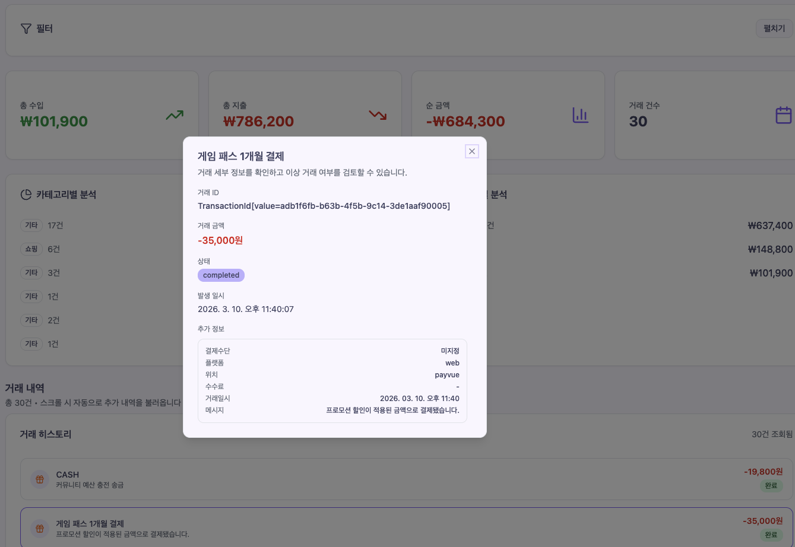

# front-react-core

Payvue의 화면, 사용자 상호작용, 클라이언트 상태와 백엔드 통신 경계를 소유하는 Next.js 웹 애플리케이션입니다.

[`payvue-core`](https://github.com/payvue/payvue-core)가 커뮤니티·자산·거래의 모델과 규칙을, [`spring-backend-monolithic`](https://github.com/payvue/spring-backend-monolithic)이 유스케이스·영속성·외부 시스템 연동을 담당한다면, 이 저장소는 그 결과를 사용자가 탐색하고 실행할 수 있는 화면을 제공합니다. 페이지와 컴포넌트뿐 아니라 REST·SSE 클라이언트, 서버 상태 캐시, OAuth·결제 callback과 화면용 모델도 이 저장소에 포함됩니다.

> 현재 버전: `0.1.0` · Next.js 14.1.3 · React 18.2.0 · TypeScript 5

## 프로젝트 경계

| `front-react-core`저장소 | 백엔드와 Core 저장소 |
| --- | --- |
| Route, Layout과 화면 조합 | 도메인 애그리게이트, 불변식과 정책 |
| 사용자 입력, 필터와 화면 전환 | 유스케이스 순서와 트랜잭션 경계 |
| API 응답을 화면 모델로 바꾸는 builder·normalizer | Repository·Gateway 계약과 기술 구현 |
| TanStack Query 캐시와 클라이언트 상태 | MySQL·Redis 영속 상태와 세션 검증 |
| Axios REST, SSE와 OAuth·결제 callback | OAuth·SMTP·PG 공급자 연동과 응답 번역 |
| 목록·상세·분석 등 결과 표현 | 거래·결제·커뮤니티 상태 전이 |

프론트엔드는 백엔드의 도메인 모델을 그대로 복제하지 않습니다. API 경계에서 받은 데이터를 화면이 필요한 모델로 해석하고, 사용자의 다음 행위를 백엔드가 이해할 수 있는 요청으로 변환합니다. 이 경계를 기준으로 화면 변경과 도메인 규칙 변경이 서로 다른 이유와 주기로 발전할 수 있습니다.

## 아키텍처 개요

### 프론트엔드 내부 구조

```text
Route / Layout
      ↓
Page Composition
      ↓
Feature Components and Hooks
      ↓
TanStack Query / Redux Toolkit / React Context
      ↓
Axios REST Client / SSE Client
      ↓
spring-backend-monolithic
```

| 계층 | 책임 |
| --- | --- |
| `app` | App Router 페이지, 공통 애플리케이션 Layout, OAuth·결제 callback |
| `components` | 여러 기능을 조합한 화면 영역과 공통 UI 컴포넌트 |
| `features` | 인증, 자산, 결제, 커뮤니티, 거래 등 기능별 모델·Hook·컴포넌트 |
| `lib/api` | Axios 설정, Bearer JWT 적용과 공통 오류 변환 |
| `lib/store` | Redux Toolkit store와 기능별 reducer 조립 |
| TanStack Query | 서버 상태 조회·변경, 캐시와 재조회 수명주기 |
| React Context | 사용자·커뮤니티·알림·결제 화면의 실행 문맥 |
| `lib/sse` | 실시간 이벤트 구독, 재연결과 이벤트 전달 |
| `shared` | 여러 기능에서 공동으로 사용하는 표현 컴포넌트와 유틸리티 |

### 화면에서 도메인 구조로

먼저 만들어진 화면, 기능과 API를 상향식으로 살펴보되 현재 구현을 곧바로 요구사항으로 간주하지 않습니다. Payvue가 해결하려는 문제와 각 기능이 함께 변경되는 이유를 확인하고, 페이지 목록이 아니라 책임과 언어를 공유하는 단위로 모듈 경계를 다시 찾습니다.

거래 내역 화면을 하나의 도메인으로 해석합니다. 필터는 사용자의 탐색 규칙, 페이징은 거래 장부의 탐색 전략, 모델은 API 데이터를 화면의 언어로 바꾸는 해석 계층, 목록과 상세 화면은 해석된 결과를 전달하는 표현 계층입니다.



> 거래 요약, 카테고리 분석, 거래 이력과 상세 정보를 한 화면에서 탐색하는 UI입니다. 화면의 모양보다 필터·조회·변환·표현이 어떤 책임으로 협력하는지를 보여주는 사례로 사용합니다.

이 관점은 `features/transaction`에 다음과 같이 반영되어 있습니다.

| 설계 역할 | 프론트엔드 구현 |
| --- | --- |
| 탐색 규칙 | `config/*-filters.ts`, `components/*-filters.tsx` |
| 조회와 페이징 | `hooks/useTransactionHistoryQuery.ts`, `hooks/useInfiniteTransactionHistoryQuery.ts` |
| API 모델 해석 | `model/*-builder.ts`, `utils/*-normalizer.ts` |
| 목록과 상세 표현 | `components/history`, `components/asset`, `components/groups` |
| 서버 상태 동기화 | TanStack Query와 SSE 이벤트에 따른 Query 캐시 무효화 |

### 상태와 데이터 흐름

REST 조회 결과는 Query 캐시에 저장하고, 화면은 API 응답을 직접 출력하기보다 feature Hook과 builder·normalizer를 거쳐 화면 모델을 소비합니다.

```text
Page
  → Feature Hook
  → TanStack Query
  → Axios REST Client
  → spring-backend-monolithic
  → API Schema
  → Builder / Normalizer
  → View Model
  → List / Detail Component
```

현재 코드는 상태의 수명주기와 공유 범위에 따라 여러 도구를 함께 사용합니다.

| 상태 종류 | 현재 소유자 | 예시 |
| --- | --- | --- |
| 원격 서버 상태 | TanStack Query | 자산 요약, 거래 이력, 결제 한도, 스토어 정보 |
| 애플리케이션 전역 상태 | Redux Toolkit | 인증, 커뮤니티, 결제, 자산, 장바구니, 스마트스토어 |
| 기능·화면 실행 문맥 | React Context | 사용자, 커뮤니티, 알림, 결제, 쇼핑 화면 조합 |
| 브라우저 로컬 상태 | localStorage와 컴포넌트 상태 | 장바구니·위시리스트·테마, 모달과 필터 UI |

일부 상태는 Redux, Context와 localStorage에 걸쳐 책임이 겹쳐 있습니다. 위 표는 현재 사용 위치를 설명하며, 장기적으로는 같은 상태의 단일 소유자와 동기화 규칙을 더 명확히 정리해야 합니다.

SSE는 별도의 원격 상태 저장소가 아니라 변경 신호로 사용합니다.

```text
spring-backend-monolithic
  → SSE event
  → AlarmProvider
  → 관련 Query key 무효화
  → REST 재조회
  → 최신 화면 모델 렌더링
```

### 전체 시스템 연결


1. 브라우저는 Next.js로 작성된 `front-react-core`를 로드합니다.
2. 프론트엔드는 JWT를 포함한 REST 요청을 `spring-backend-monolithic`에 전달합니다.
3. 백엔드는 `Controller → ApplicationService → Flow/Context → payvue-core` 순서로 유스케이스를 실행합니다.
4. 거래·초대·시스템 이벤트는 SSE로 전달되고, 프론트엔드는 관련 Query를 다시 조회합니다.
5. OAuth와 결제 흐름은 브라우저 전환 또는 popup 이후 전용 callback Route에서 결과를 이어받습니다.

> 다이어그램의 Nginx는 선택 가능한 배포 경계이며 이 저장소에 포함된 구현은 아닙니다. `payvue-core`도 독립 서버가 아니라 Gradle composite build를 통해 백엔드 프로세스에 포함됩니다.

## 프론트엔드 설계

### 1. 변경 이유에 따라 기능 경계를 나눕니다

페이지를 기준으로 모든 코드를 한곳에 모으면 같은 기능의 조회·모델·표현 코드가 여러 Route에 흩어질 수 있습니다. `features`는 화면의 위치보다 인증, 자산, 결제, 커뮤니티, 거래처럼 함께 변경되는 언어와 책임을 기준으로 나눕니다. `app`은 Route와 조합을 담당하고, 기능의 데이터 조회와 해석은 가능한 한 해당 feature에 둡니다.

### 2. 서버 상태와 클라이언트 상태를 구분합니다

백엔드가 기준인 데이터는 TanStack Query가 조회·캐시·무효화합니다. 현재 화면의 선택이나 여러 컴포넌트가 공유하는 클라이언트 상태는 Redux 또는 기능 Context가 담당합니다. 서버 응답을 Redux에 다시 복사하기보다 Query key를 기준으로 최신 데이터를 재조회하는 흐름을 우선합니다.

### 3. 외부 응답을 화면 모델로 번역합니다

거래와 자산 기능의 builder·normalizer는 API 필드와 화면 표현 사이의 번역 계층입니다. 컴포넌트가 백엔드 응답 형식과 상태 코드를 직접 해석하지 않도록 하고, 금액·날짜·카테고리·상태 표시 규칙을 기능 내부에서 일관되게 적용합니다.

### 4. 인증과 결제의 외부 왕복을 Route로 복원합니다

Google·GitHub OAuth와 결제는 외부 페이지나 popup을 거쳐 애플리케이션으로 돌아옵니다. `app/auth/oauth/*/callback`, `app/oauth/callback`, `app/payment/*` Route가 결과를 해석하고 인증 상태 또는 결제 진행 상태를 다음 화면으로 연결합니다.

### 5. 실시간 이벤트는 캐시 일관성 신호로 사용합니다

SSE 이벤트가 도착하면 알림 화면만 갱신하는 데 그치지 않고, 이벤트 종류에 따라 자산 요약·온라인 자산·거래 내역 Query를 무효화합니다. 실제 최신 상태는 다시 REST로 조회하므로 이벤트 payload와 조회 API 사이의 역할을 분리할 수 있습니다.

## 주요 애플리케이션 영역

| 영역 | 주요 경로 | 프론트엔드 책임 | 주요 코드 |
| --- | --- | --- | --- |
| Account/Auth | `/login`, `/register`, `/settings` | 로그인·가입·계정 복구, OAuth, 프로필과 결제 한도 | `features/auth`, `features/account`, `components/auth`, `components/settings` |
| Dashboard | `/dashboard` | 잔액·포인트·최근 거래 요약과 기능 진입 | `components/dashboard` |
| Asset | `/assets` | 자산 요약·결제 수단, 온라인 자산 생성과 이전 | `features/asset`, `components/assets` |
| Community | `/groups`, `/groups/[id]` | 그룹·구성원·공유 자산과 결제 요청 | `features/community`, `components/groups` |
| Payment | `/payment`, `/payment/*`, `/product-payment` | 결제 수단 선택, 결제·가상계좌·예약 결제 진행 | `features/pay`, `components/payment`, `lib/pay` |
| Transaction | `/analytics` | 거래 필터, 목록·상세·분석과 페이징 | `features/transaction`, `components/analytics` |
| Alarm | 공통 애플리케이션 Layout | 알림 조회, SSE 구독과 관련 Query 동기화 | `features/alarm`, `components/context/alarm.tsx`, `components/notifications` |
| Engineering Blog | `/blog`, `/blog/[slug]` | 설계 글 목록·상세와 정적 콘텐츠 렌더링 | `features/blog`, `app/(core)/blog` |
| Shopping / SmartStore | `/shopping`, `/smartstore` | 상품·장바구니·스토어 운영 화면의 실험적 구현 | `features/shopping`, `features/smartstore`, `features/product`, `features/cart` |

Shopping과 SmartStore는 소스와 Route가 존재하지만 타입과 모델 계약을 정리하는 중인 실험적 영역입니다. 정식 기능 범위로 승격하기 전 API 계약, 상태 소유권과 독립 타입 검증을 함께 정리해야 합니다.

## 패키지 구조

```text
front-react-core
├── app
│   ├── (core)             # 공통 애플리케이션 Layout과 주요 화면
│   ├── auth               # OAuth callback
│   ├── payment            # 결제 진행·가상계좌 화면
│   └── page.tsx           # 서비스 소개 화면
├── components
│   ├── analytics
│   ├── assets
│   ├── auth
│   ├── context            # 애플리케이션 Context Provider
│   ├── dashboard
│   ├── groups
│   ├── notifications
│   ├── payment
│   ├── settings
│   └── ui                 # 공통 UI primitives
├── features
│   ├── account
│   ├── alarm
│   ├── asset
│   ├── auth
│   ├── blog
│   ├── cart
│   ├── community
│   ├── pay
│   ├── product
│   ├── shopping
│   ├── smartstore
│   └── transaction
├── lib
│   ├── api                # REST client
│   ├── contexts           # 공통 애플리케이션 상태
│   ├── pay                # 결제 전략과 client
│   ├── redux              # typed Redux Hook과 Provider
│   ├── sse                # 실시간 이벤트 client
│   └── store              # Redux store와 reducer
├── public/images          # 상품·화면·블로그 이미지
└── shared                 # 공통 표현 컴포넌트, HOC와 유틸리티
```

## 기술 스택

- Next.js 14.1.3, React 18.2.0, TypeScript 5
- Tailwind CSS 3.4.13, Radix UI, shadcn/ui
- Redux Toolkit 2, redux-persist, React Context
- TanStack Query 5
- Axios, EventSource Polyfill
- React Hook Form
- Recharts, Framer Motion
- React Markdown, remark-gfm, Prism
- Vercel Analytics

## 로컬 실행

### 요구 사항

- Node.js 18.17 이상
- npm
- API 기능을 사용할 경우 로컬 또는 원격에서 실행 중인 [`spring-backend-monolithic`](https://github.com/payvue/spring-backend-monolithic)

### 설치

```bash
git clone https://github.com/payvue/front-react-core.git
cd front-react-core
npm ci
```

### 환경 변수

프로젝트 루트에 `.env.local`을 생성합니다.

```dotenv
NEXT_PUBLIC_PAYVUE_API_URI=http://localhost:8080
NEXT_PUBLIC_SSE_URI=http://localhost:8080

NEXT_PUBLIC_GOOGLE_OAUTH_CLIENT_ID=
NEXT_PUBLIC_GOOGLE_OAUTH_AUTHORIZE_URL=http://localhost:8080/oauth2/authorization/google
NEXT_PUBLIC_GITHUB_OAUTH_AUTHORIZE_URL=http://localhost:8080/oauth2/authorization/github
```

| 변수 | 필요한 기능 | 설명 |
| --- | --- | --- |
| `NEXT_PUBLIC_PAYVUE_API_URI` | REST API 기능 | 백엔드 API origin |
| `NEXT_PUBLIC_SSE_URI` | 실시간 알림 | SSE API origin |
| `NEXT_PUBLIC_GOOGLE_OAUTH_CLIENT_ID` | Google 로그인 | 브라우저에서 사용하는 Google OAuth Client ID |
| `NEXT_PUBLIC_GOOGLE_OAUTH_AUTHORIZE_URL` | Google 로그인 | Google OAuth를 시작하는 백엔드 URL. 기본값은 로컬 `8080` 주소입니다. |
| `NEXT_PUBLIC_GITHUB_OAUTH_AUTHORIZE_URL` | GitHub 로그인 | GitHub OAuth를 시작하는 백엔드 URL. 기본값은 로컬 `8080` 주소입니다. |

`NEXT_PUBLIC_*` 변수는 브라우저 번들에 노출되므로 secret이나 서버 전용 자격 증명을 저장하면 안 됩니다.

### 개발 서버

```bash
npm run dev
```

브라우저에서 [http://localhost:3000](http://localhost:3000)을 엽니다.

### 프로덕션 실행

```bash
npm run build
npm run start
```

## 빌드와 검증

현재 리비전은 다음 명령으로 프로덕션 번들을 생성할 수 있습니다.

```bash
npm ci
npm run build
```

현재 `next.config.mjs`는 프로덕션 빌드 중 TypeScript와 ESLint 검사를 생략합니다. 따라서 `npm run build` 성공은 Route와 번들 생성을 확인하지만 타입 안전성과 린트 통과까지 증명하지 않습니다.

- 독립 `npx tsc --noEmit` 검사는 현재 남아 있는 타입·모델 계약 오류를 보고합니다.
- `npm run lint`는 ESLint 초기 설정을 마치기 전까지 CI 검사로 사용할 수 없습니다.
- 자동화된 테스트 파일과 `test` 스크립트는 아직 없습니다.

타입, 린트와 테스트가 정식 품질 게이트로 연결되면 이 섹션의 검증 명령과 보장 범위를 함께 갱신해야 합니다.

## Engineering Blog

`/blog`에는 Payvue를 구현하며 정리한 설계와 도메인 모델링 기록이 포함되어 있습니다.

| 글 | 애플리케이션 경로 | 주제 |
| --- | --- | --- |
| [`[설계] Theory`](https://github.com/payvue/front-react-core/blob/e6b1803deeb42900a868a9c63f4fc5639014f0d5/features/blog/data/posts.ts#L57) | `/blog/design-intent-in-code` | 객체지향 설계, 책임 기반 협력과 DDD |
| [`[설계] Core`](https://github.com/payvue/front-react-core/blob/e6b1803deeb42900a868a9c63f4fc5639014f0d5/features/blog/data/posts.ts#L144) | `/blog/design-core` | 프론트엔드 데모에서 출발한 소프트웨어 분석, Core Domain과 Distillation |
| [`[구현] DDD`](https://github.com/payvue/front-react-core/blob/e6b1803deeb42900a868a9c63f4fc5639014f0d5/features/blog/data/posts.ts#L372) | `/blog/implementation-ddd` | 거래 화면의 도메인 해석, 실행 컨텍스트, 타입 계층과 응용 계층 구현 |

글과 이미지 데이터는 `features/blog/data/posts.ts`와 `public/images/blog`에서 관리합니다.

## 설계 자료 출처

프론트엔드 구조와 거래 화면 설명은 이 저장소의 블로그 `[설계] Core`, `[구현] DDD`와 실제 `features` 코드를 함께 기준으로 작성했습니다. 블로그 자료를 확인한 기준 리비전은 [`e6b1803`](https://github.com/payvue/front-react-core/commit/e6b1803deeb42900a868a9c63f4fc5639014f0d5)입니다.

전체 시스템 아키텍처 이미지는 [`spring-backend-monolithic@e3b4a51`](https://github.com/payvue/spring-backend-monolithic/blob/e3b4a5176adec6ec77c6a8286c4eaa7be9996893/README.md)가 소유하는 자료를 커밋 permalink로 참조합니다. 프론트엔드와 백엔드의 프로젝트 경계는 [`payvue-core@1bfe9c8`](https://github.com/payvue/payvue-core/blob/1bfe9c8faef9af9fdc9288c87df91157737e36fc/README.md)의 Abstract Core 경계 설명과 백엔드 README를 대조했습니다.

다이어그램과 블로그 글은 설계 의도를 설명하는 스냅샷입니다. 현재 구현에 대한 최종 기준은 이 저장소의 실제 소스, `package.json`과 `next.config.mjs`입니다.
